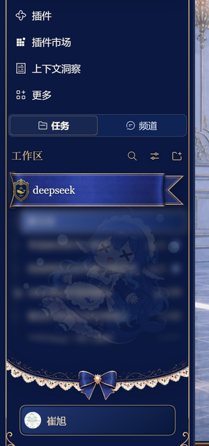
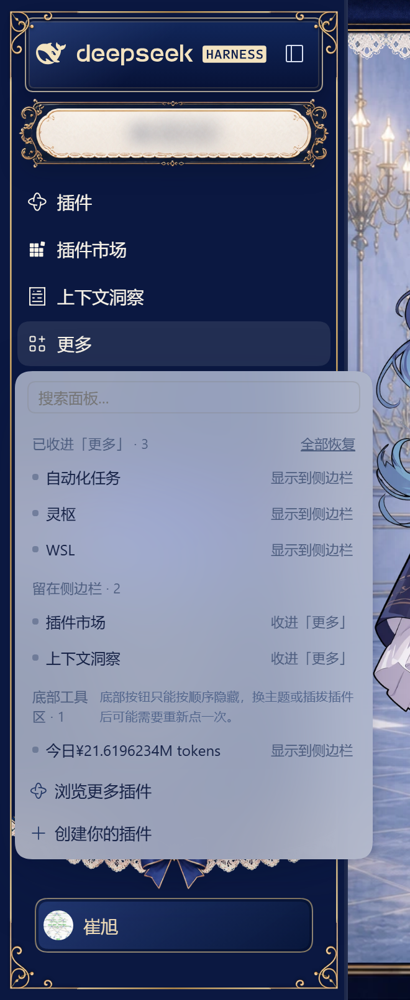
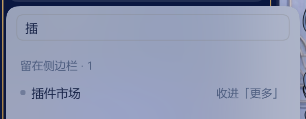

# dsh-sidebar-overflow

> **把左侧边栏里不常用的入口收进「更多」，哪些留在外面由你决定。**
> 点一下收起、点一下放回，改完立刻生效，DSH 重启后依然记得。

[](https://github.com/cxv117793-blip/dsh-sidebar-overflow/releases/latest)
[](https://github.com/deepseek-ai)
[](package.json)
[](LICENSE)

**中文** ｜ [English](#english)

DSH 的左侧边栏装得下十几个入口之后就开始拥挤：插件、插件市场、自动化任务、灵枢、上下文洞察、WSL…… 常用的其实没几个。

这个插件**不新增按钮、也不改官方侧边栏的行为**。它往官方的 `sidebar.panellist.actions` 槽位注册一条，官方那条「更多」就会出现在**主导航列表末尾**；点开是一张清单，列出当前所有入口，**每个都能单独决定留在侧边栏还是收进「更多」**。

收进去的没有消失 —— 点「更多」照样能打开，点「显示到侧边栏」就回来。

## 效果

| 收起之后 | 菜单里可以逐个切换 |
|---|---|
|  |  |

菜单顶部的搜索框，入口多了以后按名字筛：



## 功能

| | |
|---|---|
| **逐个选择** | 菜单里列出全部入口，一行一个，右边一个按钮切换「收进『更多』/ 显示到侧边栏」 |
| **搜索过滤** | 菜单顶部有搜索框，输两个字就筛出来；无匹配时给明确空态，不会误显示成「还没收起任何按钮」 |
| **一键还原** | 「全部恢复」把 `panel:` 与 `footer:` 两类键一次清空，全部放回 |
| **失效条目清理** | 插件卸载后配置里会残留 `panel:<已删除的id>`，菜单会提示「另有 N 个条目已失效」，点「全部恢复」即可清掉 |
| **底部工具区** | 侧边栏底部那排小按钮（用量、余额之类）也能隐藏 |
| **即时生效** | 点完就变，不用刷新、不用重启 |
| **重启保留** | 选择写进 profile 的 `cordis.patch.yml`，DSH 重启后自动回放 |
| **中英双语** | 跟随 DSH 语言设置 |

## 安装

桌面版**不要**用 `dsh plugin --profile desktop ...` 改 profile —— 该 profile 由应用内的插件管理器独占，命令行会直接拒绝（`profile "desktop" is managed exclusively by the Electron application`）。

三种装法，任选其一：

### 1. 从本地目录（开发/自用最常见）

`设置 → 插件 → 添加插件 → 从本地目录`，选中本仓库根目录。

### 2. 从 GitHub 仓库

在同一个安装框里粘贴：

```text
https://github.com/cxv117793-blip/dsh-sidebar-overflow
```

### 3. 从 Release 的 `.tgz`

三个地址，按需选：

| 用途 | 地址 |
|---|---|
| 永远指向最新版（文件名固定） | `https://github.com/cxv117793-blip/dsh-sidebar-overflow/releases/latest/download/dsh-sidebar-overflow.tgz` |
| 锁定 v0.1.0 | `https://github.com/cxv117793-blip/dsh-sidebar-overflow/releases/download/v0.1.0/dsh-sidebar-overflow-0.1.0.tgz` |

也可以先下载再装：

```bash
curl -L -o dsh-sidebar-overflow.tgz \
  https://github.com/cxv117793-blip/dsh-sidebar-overflow/releases/latest/download/dsh-sidebar-overflow.tgz
```

非 desktop 的 profile 才可以用命令行：

```bash
dsh plugin --profile <你的profile> add file:<本仓库绝对路径>
```

### 装完之后

**完全退出应用**（`文件 → 退出`，或托盘右键退出）再启动。

刷新页面不够 —— 客户端模块只在应用启动时装配一次。这一步没做，界面不会出现「更多」。装好后主导航列表末尾会多出一行「更多」（宽侧边栏时带文字，窄侧边栏时只有一个图标）。

## 使用

点侧边栏里的「更多」：

- **已收进「更多」** 分组：点右边「显示到侧边栏」把它放回；
- **留在侧边栏** 分组：点右边「收进『更多』」把它挪走；
- **底部工具区** 分组：底部那排按钮，同样两个方向的切换；
- 分组标题右侧有「全部恢复」。

「插件」这个入口是**故意锁死**的 —— 它是插件管理器的入口，收起来就没地方装插件了。点它会提示「该面板不能收起」。

「更多」按钮是**常驻**的：插件一装上，它就在主导航列表末尾，不管你有没有收过东西（因为插件往 `sidebar.panellist.actions` 槽位注册了一条，官方 shell 只要看到该槽位非空就渲染这个按钮）。全部恢复后按钮不会消失，但菜单会显示「还没有收起来的按钮」，侧边栏看起来和没装插件时一样。

## 配置

选择存在 profile 的 `cordis.patch.yml` 里，由插件自己的 `Config` 声明：

```yaml
- id: dsh-sidebar-overflow
  name: dsh-sidebar-overflow
  config:
    hidden:
      - panel:dsh-wsl
      - panel:dsh-market
      - footer:0
```

键名规则：

| 前缀 | 含义 | 例子 |
|---|---|---|
| `panel:` | 主导航面板，后接 `sidebar.panellist` 里的面板 id | `panel:dsh-wsl` |
| `footer:` | 底部工具区第 N 个按钮（按渲染顺序，**从 0 数**） | `footer:0` |

`footer:` 记的是**位置**而不是 id —— 那些按钮渲染进 DOM 时既不带 id 也没有 data 标记，只能数位置。这是本插件最主要的粗糙之处，见下面的「已知限制」。

手工改法：改完**完全退出**再启动。想重置就删掉 `hidden` 整段（等价于空数组）。

## 工作原理

全部走官方扩展点，不劫持 DOM 结构、不打补丁、不替换组件：

1. **让「更多」按钮出现**
   官方 sidebar shell 里 `hasEntryActions` 直接来自 `ctx.slots.entriesOfSlot("sidebar.panellist.actions").length > 0`。本插件注册一条进该槽位，官方按钮就渲染出来，菜单内容由我们提供。

2. **控制主列表显示谁**
   官方 shell 用 `panels.filter(({ id }) => id === "plugins" || !unpinned.includes(id))` 决定主列表，`unpinned` 来自 `createPanelPins()` 的内存 store。它的写入口 `setPinned(id, pinned)` 由 sidebar 插件通过 `injectProps()` 下发；本插件在 `apply()` 里从 `ctx.slots.entriesOfSlot("sidebar")[0].inject()` 取到**同一份闭包**，所以启动时不用打开菜单就能恢复收纳状态。

   `setPinned` 是幂等的（状态已一致就直接 return），所以重复调用不会引发重渲染循环。

3. **持久化**
   官方 pin store 是纯内存态（刷新即还原）。落盘由本插件 Host 半边的 `Config`（`hidden: string[]`）承担，走 `configForms` 实时读写 —— 点一下立刻写进 `cordis.patch.yml`。

   字段全部标了 `.volatile()`：它的语义是「值变化不触发插件重载」，**不是**「不落盘」。配置照常写入磁盘。

4. **底部工具区**
   `sidebar.footer.action` 没有对应的官方 pin 机制，只能按 DOM 兄弟节点顺序做 best-effort 隐藏；匹配不到就静默跳过，不影响主功能。

Host 半边（`lib/index.js`）只有 43 行，只声明设置项，`apply()` 是故意空的。

## 已知限制

| 限制 | 原因 |
|---|---|
| 底部工具区按**顺序**而不是按 id 记忆 | 那些按钮渲染进 DOM 时既不带 id 也没有 data 标记，只能数位置。加减插件后序号会变，表现为「隐藏错了一个」 |
| 换主题后底部隐藏可能失效 | 同上，主题可能改变节点层级 |
| 「插件」入口不能收 | 锁死的，见上 |
| 没有拖拽排序 | 这一版只做「收起 / 显示」，不做重排 |
| 菜单不记忆滚动位置 | 每次打开都从顶部开始 |

如果底部那条「失效条目」的提示一直在，点「全部恢复」就能清干净。

## 常见问题

**装完看不到「更多」按钮？**
按钮是常驻的，正常情况下装完并完全退出重启后就会出现。看不到的话，首先确认确实**完全退出应用**了 —— 客户端模块只在启动时装配，刷新页面不算。再确认插件在 `设置 → 插件` 里是启用状态。

**刷新页面后收纳状态没了？**
说明配置没写进磁盘。检查 `设置 → 插件 → dsh-sidebar-overflow` 是否有设置项，以及 profile 的 `cordis.patch.yml` 里有没有 `config.hidden`。本插件启动时的恢复依赖这份配置。

**底部那个按钮隐藏错了位置？**
这就是「按顺序记忆」的代价：装/卸插件后序号整体平移。打开菜单，把当前错位的那两项重新点一遍即可。

**会不会把侧边栏搞坏？**
不会。插件停用/卸载时会把官方 pin store 还原成全可见、并用 `data-dso-hid` 标记还原被藏起来的底部按钮，不需要刷新自救。所有 DOM 操作都包在 `try/catch` 里，取不到元素就静默跳过。

**支持哪些 DSH 版本？**
开发与实测环境是 DSH **0.2.1-rc.3**（CLI `0.2.0-rc.2`）。插件只依赖 `slots`、`locale`、`configForms` 三个长期稳定的服务面，没有声明 `engines.dsh` 硬约束 —— 但它确实没有在更老的版本上验证过。

## 安全边界

- **不写会话数据**、不联网、不上报，不读对话内容。
- 只写一个配置字段：profile 的 `cordis.patch.yml` 里 `dsh-sidebar-overflow` 的 `config.hidden`。
- 客户端半边崩溃只会影响侧边栏，不会白屏。
- 卸载后 `hidden` 配置会残留，但不影响任何东西；想干净就删掉那几行。

## 开发

没有构建步骤 —— 源码直接就是产物。

```bash
git clone https://github.com/cxv117793-blip/dsh-sidebar-overflow.git
cd dsh-sidebar-overflow

node --check lib/client.js
node --check lib/index.js
```

装到本地 profile 调试（desktop 用应用内「从本地目录」安装）：

```bash
dsh plugin --profile <profile> add file:<本仓库绝对路径>
```

改完客户端代码后**完全退出应用**再启动；只刷新页面不会重新加载模块。

结构：

```text
lib/index.js      宿主半边：只声明 Config，43 行
lib/client.js     浏览器半边：菜单 UI + 收纳逻辑，816 行
locale/{zh,en}.json
cordis.patch.yml  loader 补丁，告诉 DSH 有这么一个插件
icon.svg
docs/             README 用的截图（不打进 npm 包）
```

## English

**dsh-sidebar-overflow** adds a **More** entry to the end of the DeepSeek Harness
left sidebar's panel list, so you can choose — entry by entry — which icons stay visible
and which collapse into that menu.

DSH's left rail gets crowded fast once a handful of plugins are installed. The plugin
lists every entry in one menu and lets you toggle each of them between *in the sidebar*
and *collected into More*. Collected entries are not gone — one click on **More** and
they are back.


Highlights:

- **Per-entry control.** Every row has a button that flips it between visible and collected.
- **Search.** A filter box at the top of the menu; a distinct empty state when nothing matches.
- **Restore all.** One button clears both `panel:` and `footer:` keys and puts everything back.
- **Stale-key cleanup.** Uninstalled plugins leave `panel:<id>` entries behind; the menu reports them and Restore all removes them.
- **Footer actions.** The small buttons at the bottom of the rail (usage, balance, …) can be hidden too.
- **Instant, and it survives restarts.** Selections are written to the profile's `cordis.patch.yml`
  and replayed on the next launch.
- **Bilingual** — follows the DSH language setting.

### Install

Desktop profiles are owned by the in-app plugin manager; `dsh plugin --profile desktop ...`
is refused on purpose. Use *Settings → Plugins → Add plugin* and pick either the cloned
directory, the GitHub URL, or a `.tgz` from
[Releases](https://github.com/cxv117793-blip/dsh-sidebar-overflow/releases/latest).

Then **fully quit** the app — reloading the page does not load the client module.

Non-desktop profiles can use the CLI:

```bash
dsh plugin --profile <profile> add file:<absolute-path-to-this-repo>
```

### How it works

Everything goes through official extension points — no DOM hijacking, no monkey-patching,
no component replacement:

1. The More button is what the stock sidebar renders when `sidebar.panellist.actions` is
   non-empty (`entriesOfSlot(...).length > 0`). We register one entry there and supply the
   menu body.
2. Visibility is driven by the stock `setPinned()` closure, obtained from
   `ctx.slots.entriesOfSlot("sidebar")[0].inject()` — the same closure the shell itself uses,
   so state is restored at startup without opening the menu.
3. Persistence is the plugin's own Host `Config` (`hidden: string[]`), written live through
   `configForms` into the profile's `cordis.patch.yml`. Fields are marked `.volatile()`,
   which means "do not reload the plugin on change" — not "do not persist".
4. Footer actions have no official pin mechanism, so they are hidden best-effort by DOM
   sibling order.

### Known limitation

Footer actions are remembered **by position**, not by id, because those buttons render
without any identifier. After installing or removing plugins the indices shift; toggle them
again if a hide lands on the wrong button.

### Compatibility

Developed and tested against DSH **0.2.1-rc.3**. The plugin declares no `engines.dsh`
constraint; it only relies on the `slots`, `locale` and `configForms` service faces, but has
not been verified on older releases.

Requires Node `^22.19.0 || >=24.0.0`.

## License

[MIT](LICENSE)
